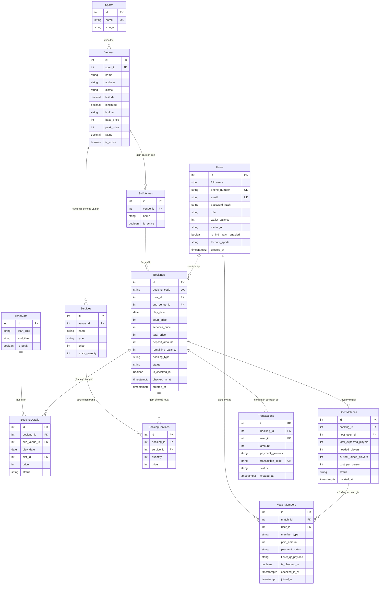

# 🗄️ Thiết kế Cơ sở dữ liệu (Database Schema Specification)

Hệ thống phân bổ dữ liệu thành 2 tầng kiến trúc:  
1. **Central Database (Cloud):** PostgreSQL trên Supabase (kết nối qua ASP.NET Core EF Core 8).  
2. **Client Database (Offline):** SQLite nội bộ trên ứng dụng di động Flutter (qua package `sqflite`).

---

## 1. Sơ đồ quan hệ thực thể (ERD - Cloud Database PostgreSQL)



---

## 2. Thiết kế Local Database (SQLite - Flutter Client)

### 2.1. Bảng `user_session` (Quản lý phiên & Đăng nhập tự động)
```sql
CREATE TABLE IF NOT EXISTS user_session (
    user_id INTEGER PRIMARY KEY,
    full_name TEXT NOT NULL,
    phone_number TEXT NOT NULL,
    email TEXT,
    role TEXT NOT NULL,
    wallet_balance INTEGER NOT NULL DEFAULT 0,
    access_token TEXT NOT NULL,
    logged_in_at TEXT NOT NULL
);
```

### 2.2. Bảng `app_settings` (Cấu hình ứng dụng & Chế độ tìm kèo)
```sql
CREATE TABLE IF NOT EXISTS app_settings (
    setting_key TEXT PRIMARY KEY,
    setting_value TEXT NOT NULL,
    updated_at TEXT NOT NULL
);
```

### 2.3. Bảng `offline_bookings` (Vé đặt sân & Mã QR check-in ngoại tuyến)
```sql
CREATE TABLE IF NOT EXISTS offline_bookings (
    booking_code TEXT PRIMARY KEY,
    venue_id INTEGER NOT NULL,
    venue_name TEXT NOT NULL,
    sport_name TEXT NOT NULL,
    sub_venue_name TEXT NOT NULL,
    address TEXT NOT NULL,
    play_date TEXT NOT NULL,
    time_slots TEXT NOT NULL,
    user_role_in_match TEXT NOT NULL, -- 'Host' hoặc 'JoinedPlayer'
    total_price INTEGER NOT NULL,
    deposit_amount INTEGER NOT NULL,
    status TEXT NOT NULL,             -- 'Upcoming', 'Completed', 'Cancelled'
    qr_payload TEXT NOT NULL,
    is_checked_in INTEGER NOT NULL DEFAULT 0,
    notification_id INTEGER NOT NULL,
    created_at TEXT NOT NULL
);
```

### 2.4. Bảng `favorites` (Danh sách sân yêu thích ngoại tuyến)
```sql
CREATE TABLE IF NOT EXISTS favorites (
    venue_id INTEGER PRIMARY KEY,
    sport_name TEXT NOT NULL,
    venue_name TEXT NOT NULL,
    address TEXT NOT NULL,
    image_url TEXT,
    rating REAL NOT NULL DEFAULT 5.0,
    base_price INTEGER NOT NULL,
    created_at TEXT NOT NULL
);
```

---

## 3. DDL Script Tạo Bảng Central Database (PostgreSQL - Supabase)

```sql
-- 1. Bảng Users (Bổ sung wallet_balance, avatar_url, cấu hình tìm kèo)
CREATE TABLE IF NOT EXISTS "Users" (
    id SERIAL PRIMARY KEY,
    full_name VARCHAR(100) NOT NULL,
    phone_number VARCHAR(20) NOT NULL UNIQUE,
    email VARCHAR(150) UNIQUE,
    password_hash VARCHAR(255) NOT NULL,
    role VARCHAR(30) NOT NULL DEFAULT 'Player', -- 'Player', 'VenueStaff', 'Admin'
    wallet_balance INT NOT NULL DEFAULT 0,       -- Số dư ví hoàn cọc/hủy trận
    avatar_url VARCHAR(255),
    is_find_match_enabled BOOLEAN NOT NULL DEFAULT FALSE,
    favorite_sports VARCHAR(255) DEFAULT 'Cầu lông,Bóng đá mini',
    created_at TIMESTAMPTZ NOT NULL DEFAULT NOW()
);

-- 2. Bảng Sports (Bộ môn)
CREATE TABLE IF NOT EXISTS "Sports" (
    id SERIAL PRIMARY KEY,
    name VARCHAR(50) NOT NULL UNIQUE,
    icon_url VARCHAR(255)
);

-- 3. Bảng Venues (Cụm sân - tọa độ Lat/Long để quét bán kính)
CREATE TABLE IF NOT EXISTS "Venues" (
    id SERIAL PRIMARY KEY,
    sport_id INT NOT NULL REFERENCES "Sports"(id) ON DELETE CASCADE,
    name VARCHAR(150) NOT NULL,
    address VARCHAR(255) NOT NULL,
    district VARCHAR(100) NOT NULL,
    latitude DECIMAL(10,7) NOT NULL,
    longitude DECIMAL(10,7) NOT NULL,
    description TEXT,
    hotline VARCHAR(20) NOT NULL,
    image_url VARCHAR(255),
    base_price INT NOT NULL,
    peak_price INT NOT NULL,
    rating DECIMAL(2,1) NOT NULL DEFAULT 5.0,
    amenities TEXT,
    is_active BOOLEAN NOT NULL DEFAULT TRUE
);

-- 4. Bảng SubVenues (Sân con - Hỗ trợ trạng thái hoạt động/bảo trì)
CREATE TABLE IF NOT EXISTS "SubVenues" (
    id SERIAL PRIMARY KEY,
    venue_id INT NOT NULL REFERENCES "Venues"(id) ON DELETE CASCADE,
    name VARCHAR(50) NOT NULL,
    is_active BOOLEAN NOT NULL DEFAULT TRUE
);

-- 5. Bảng Services (Đồ thuê & Phụ kiện bán tại sân)
CREATE TABLE IF NOT EXISTS "Services" (
    id SERIAL PRIMARY KEY,
    venue_id INT NOT NULL REFERENCES "Venues"(id) ON DELETE CASCADE,
    name VARCHAR(100) NOT NULL,
    type VARCHAR(20) NOT NULL, -- 'Rental' hoặc 'Sale'
    price INT NOT NULL,
    stock_quantity INT NOT NULL DEFAULT 0
);

-- 6. Bảng TimeSlots (Khung giờ)
CREATE TABLE IF NOT EXISTS "TimeSlots" (
    id SERIAL PRIMARY KEY,
    start_time VARCHAR(10) NOT NULL,
    end_time VARCHAR(10) NOT NULL,
    is_peak BOOLEAN NOT NULL DEFAULT FALSE
);

-- 7. Bảng Bookings (Đơn đặt sân - Hỗ trợ cọc, số dư còn lại, trạng thái check-in)
CREATE TABLE IF NOT EXISTS "Bookings" (
    id SERIAL PRIMARY KEY,
    booking_code VARCHAR(20) NOT NULL UNIQUE,
    user_id INT NOT NULL REFERENCES "Users"(id) ON DELETE CASCADE,
    sub_venue_id INT NOT NULL REFERENCES "SubVenues"(id) ON DELETE CASCADE,
    play_date DATE NOT NULL,
    court_price INT NOT NULL,
    services_price INT NOT NULL DEFAULT 0,
    total_price INT NOT NULL,
    deposit_amount INT NOT NULL,
    remaining_balance INT NOT NULL,                       -- Số tiền sân còn thiếu của Host (tự động trừ khi có vãng lai đóng tiền)
    booking_type VARCHAR(30) NOT NULL DEFAULT 'Standard', -- 'Standard', 'Recurring', 'OpenMatch'
    status VARCHAR(30) NOT NULL DEFAULT 'Upcoming',       -- 'PendingPayment', 'Upcoming', 'Completed', 'Cancelled'
    is_checked_in BOOLEAN NOT NULL DEFAULT FALSE,
    checked_in_at TIMESTAMPTZ,
    created_at TIMESTAMPTZ NOT NULL DEFAULT NOW()
);

-- 8. Bảng BookingDetails (Chi tiết slot - Chống trùng lịch cấp Database)
CREATE TABLE IF NOT EXISTS "BookingDetails" (
    id SERIAL PRIMARY KEY,
    booking_id INT NOT NULL REFERENCES "Bookings"(id) ON DELETE CASCADE,
    sub_venue_id INT NOT NULL REFERENCES "SubVenues"(id) ON DELETE CASCADE,
    play_date DATE NOT NULL,
    slot_id INT NOT NULL REFERENCES "TimeSlots"(id) ON DELETE RESTRICT,
    price INT NOT NULL,
    status VARCHAR(30) NOT NULL DEFAULT 'Upcoming', -- Khớp theo Bookings.status
    CONSTRAINT UQ_Booking_SingleSlot UNIQUE (booking_id, slot_id)
);

-- RÀNG BUỘC CHỐNG TRÙNG LỊCH: Ngăn 2 booking khác nhau đặt cùng 1 sân con + 1 ngày + 1 slot (chỉ áp dụng đơn chưa hủy)
CREATE UNIQUE INDEX IF NOT EXISTS UQ_SubVenue_Date_Slot_Active 
ON "BookingDetails" (sub_venue_id, play_date, slot_id) 
WHERE status != 'Cancelled';

-- 9. Bảng BookingServices (Chi tiết đồ thuê/mua kèm theo)
CREATE TABLE IF NOT EXISTS "BookingServices" (
    id SERIAL PRIMARY KEY,
    booking_id INT NOT NULL REFERENCES "Bookings"(id) ON DELETE CASCADE,
    service_id INT NOT NULL REFERENCES "Services"(id) ON DELETE RESTRICT,
    quantity INT NOT NULL,
    price INT NOT NULL
);

-- 10. Bảng OpenMatches (Tuyển vãng lai - Lưu số người và tiền chia tự động)
CREATE TABLE IF NOT EXISTS "OpenMatches" (
    id SERIAL PRIMARY KEY,
    booking_id INT NOT NULL REFERENCES "Bookings"(id) ON DELETE CASCADE,
    host_user_id INT NOT NULL REFERENCES "Users"(id) ON DELETE CASCADE,
    total_expected_players INT NOT NULL,
    needed_players INT NOT NULL,
    current_joined_players INT NOT NULL DEFAULT 0,
    cost_per_person INT NOT NULL,
    status VARCHAR(20) NOT NULL DEFAULT 'Open', -- 'Open', 'Full', 'Stopped', 'Cancelled'
    created_at TIMESTAMPTZ NOT NULL DEFAULT NOW()
);

-- 11. Bảng MatchMembers (Thành viên vãng lai tham gia qua App hoặc gán tại Quầy - có mã QR vé riêng)
CREATE TABLE IF NOT EXISTS "MatchMembers" (
    id SERIAL PRIMARY KEY,
    match_id INT NOT NULL REFERENCES "OpenMatches"(id) ON DELETE CASCADE,
    user_id INT REFERENCES "Users"(id) ON DELETE SET NULL, -- Null nếu gán khách lẻ tại quầy
    member_type VARCHAR(20) NOT NULL DEFAULT 'AppUser',   -- 'AppUser' hoặc 'WalkInAtDesk'
    paid_amount INT NOT NULL,
    payment_status VARCHAR(20) NOT NULL DEFAULT 'Paid',
    ticket_qr_payload VARCHAR(255),                       -- Chuỗi sinh mã QR riêng cho thành viên
    is_checked_in BOOLEAN NOT NULL DEFAULT FALSE,
    checked_in_at TIMESTAMPTZ,
    joined_at TIMESTAMPTZ NOT NULL DEFAULT NOW()
);

-- 12. Bảng Transactions (Quản lý dòng tiền - Ai cầm tiền?)
CREATE TABLE IF NOT EXISTS "Transactions" (
    id SERIAL PRIMARY KEY,
    booking_id INT NOT NULL REFERENCES "Bookings"(id) ON DELETE CASCADE,
    user_id INT NOT NULL REFERENCES "Users"(id) ON DELETE CASCADE,
    amount INT NOT NULL,
    payment_gateway VARCHAR(30) NOT NULL, -- 'VNPay', 'MoMo', 'MockPayment'
    transaction_code VARCHAR(100) NOT NULL UNIQUE,
    status VARCHAR(30) NOT NULL DEFAULT 'Holding', -- 'Holding' (Sàn giữ), 'Settled' (Quyết toán chủ sân), 'Refunded'
    created_at TIMESTAMPTZ NOT NULL DEFAULT NOW()
);
```

---

## 4. Script Chèn Dữ Liệu Mẫu (Sample Seed Data)

```sql
-- Seed Danh mục thể thao
INSERT INTO "Sports" (name, icon_url) VALUES
('Cầu lông', 'https://cdn-icons-png.flaticon.com/512/2906/2906478.png'),
('Pickleball', 'https://cdn-icons-png.flaticon.com/512/8144/8144709.png'),
('Bóng đá mini', 'https://cdn-icons-png.flaticon.com/512/861/861512.png'),
('Bóng rổ', 'https://cdn-icons-png.flaticon.com/512/889/889455.png')
ON CONFLICT (name) DO NOTHING;

-- Seed Khung giờ mẫu (Khung giờ tiêu chuẩn 6:00 - 22:00)
INSERT INTO "TimeSlots" (id, start_time, end_time, is_peak) VALUES
(1, '06:00', '07:00', false),
(2, '07:00', '08:00', false),
(3, '08:00', '09:00', false),
(4, '09:00', '10:00', false),
(5, '10:00', '11:00', false),
(6, '14:00', '15:00', false),
(7, '15:00', '16:00', false),
(8, '16:00', '17:00', false),
(9, '17:00', '18:00', true),
(10, '18:00', '19:00', true),
(11, '19:00', '20:00', true),
(12, '20:00', '21:00', true),
(13, '21:00', '22:00', true)
ON CONFLICT (id) DO NOTHING;

-- Seed Cụm sân mẫu (Tọa độ tại Cầu Giấy & Mỹ Đình)
INSERT INTO "Venues" (sport_id, name, address, district, latitude, longitude, description, hotline, base_price, peak_price, rating, amenities, is_active) VALUES
(1, 'CLB Cầu Lông Cầu Giấy', 'Số 35 Trần Quý Kiên, Dịch Vọng', 'Cầu Giấy', 21.0368000, 105.7905000, 'Cụm 6 sân thảm tiêu chuẩn thi đấu.', '0987654321', 90000, 120000, 4.9, 'Bãi đỗ ô tô, Căn tin, Phòng tắm, Cho thuê vợt', true),
(2, 'Sân Pickleball D-Sport', 'Khu thể thao Mỹ Đình, Lê Đức Thọ', 'Nam Từ Liêm', 21.0205000, 105.7635000, 'Cụm sân Pickleball có mái che hiện đại.', '0912345678', 130000, 160000, 4.8, 'Bãi đỗ xe máy, Căn tin, Wifi, Cho thuê vợt bóng', true);

-- Seed Sân con
INSERT INTO "SubVenues" (venue_id, name, is_active) VALUES
(1, 'Sân Số 1 (Thảm Yonex)', true),
(1, 'Sân Số 2 (Thảm Yonex)', true),
(1, 'Sân VIP (Khán đài)', true),
(2, 'Sân Pickleball A1', true),
(2, 'Sân Pickleball A2', true);

-- Seed Dịch vụ gia tăng (Đồ thuê & Đồ bán)
INSERT INTO "Services" (venue_id, name, type, price, stock_quantity) VALUES
(1, 'Thuê vợt Yonex Astrox', 'Rental', 30000, 20),
(1, 'Mua ống cầu Hải Yến (12 quả)', 'Sale', 240000, 50),
(1, 'Mua đôi vớ thể thao dệt kim', 'Sale', 25000, 100),
(1, 'Nước điện giải Pocari Sweat', 'Sale', 15000, 200),
(2, 'Thuê vợt Pickleball Selkirk', 'Rental', 40000, 15),
(2, 'Mua bóng Pickleball Franklin X-40 (Quả)', 'Sale', 50000, 80);
```
