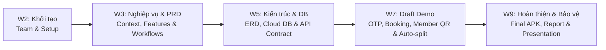

# 🎯 Tôn Chỉ Dự Án (Project Charter)

## 1. Thông tin chung
* **Tên dự án:** SportSpot – Multi-Sport Venue Booking & Match-Finding Platform
* **Mã môn học:** PRM393 - Mobile Programming
* **Học kỳ:** Fall 2026
* **Nhóm thực hiện:** Nhóm 2
* **Nền tảng mục tiêu:** Android Mobile App (Flutter SDK) kết hợp Backend RESTful API (ASP.NET Core Web API .NET 8).

---

## 2. Tuyên bố sứ mệnh & Tầm nhìn (Mission & Vision)
* **Sứ mệnh (Mission):** Đơn giản hóa toàn diện quy trình tìm kiếm, đặt lịch sân thể thao phong trào, giải quyết triệt để vấn nạn thiếu người chơi thông qua cơ chế tuyển vãng lai 2 chiều và xóa bỏ rào cản mất sóng mạng bằng vé điện tử ngoại tuyến (Offline QR Pass).
* **Tầm nhìn (Vision):** Trở thành nền tảng di động số 1 kết nối các cộng đồng thể thao phong trào (Bóng đá mini, Cầu lông, Pickleball, Bóng rổ) tại các đô thị lớn (TP.HCM, Hà Nội).

---

## 3. Mục tiêu dự án bám sát Chuẩn đầu ra (Course Learning Outcomes - CLOs)
1. **CLO 1 (Mobile UI/UX Excellence):** Xây dựng giao diện di động chuẩn Material 3 trên Flutter, trực quan, mượt mà, phản hồi real-time, áp dụng phong cách Soft Glassmorphism & Athletic Pastel Blue.
2. **CLO 2 (Advanced Data Management):** Kết hợp hài hòa giữa **Cloud Database (Supabase PostgreSQL)** và **Local Storage (SQLite + SharedPreferences)** theo mô hình Offline-first.
3. **CLO 3 (Hardware & System Integration):** Khai thác tối đa tính năng phần cứng thiết bị di động gồm: **Camera QR Scanner**, **On-device QR Generator (`qr_flutter`)**, **Local Notifications Engine (`flutter_local_notifications`)**, và **Định vị Geolocation (GPS)**.
4. **CLO 4 (Clean Architecture & API Contract):** Tổ chức mã nguồn phân tầng rõ ràng (UI - State - Data), tích hợp mượt mà với RESTful Web API (.NET 8) và dịch vụ lưu trữ media đám mây (Cloudinary CDN).

---

## 4. Lộ trình phát triển & Các mốc quan trọng (Milestones Roadmap)

| Tuần | Giai đoạn | Nội dung công việc chi tiết | Kết quả đầu ra (Deliverables) | Tiêu chí hoàn thành (DoD) |
| :---: | :--- | :--- | :--- | :--- |
| **W2** | **Team & Project Initialization** | • Bầu nhóm trưởng, phân chia vai trò. • Thống nhất ý tưởng đề tài, tech stack và quy ước Git Flow. | • Project Charter & Git Repository. | 100% thành viên clone và build thành công project template. |
| **W3** | **Business Context & Requirements** | • Khảo sát thị trường, xác định bài toán & stakeholder. • Thiết kế Context Diagram chuẩn 8 Entities. • Xây dựng bộ tài liệu PRD hoàn chỉnh. | • `01_PRODUCT_OVERVIEW.md` • `03_FUNCTIONAL_REQUIREMENTS.md` • `05_BUSINESS_RULES.md` • `07_USECASES_WORKFLOWS.md` | Giảng viên thông qua 100% danh mục tính năng và luồng nghiệp vụ. |
| **W5** | **System Architecture & Data Modeling** | • Thiết kế ERD 3 cấp độ (Conceptual, Logical, Physical). • Thiết lập Cloud Database (Supabase PostgreSQL) & Local SQLite. • Thiết kế sơ đồ System Architecture và đặc tả API Contract. | • `02_SYSTEM_ARCHITECTURE.md` • `06_DATA_SPECIFICATION_ERD.md` • `08_API_CONTRACT.md` • File DDL script & Seed Data. | Cloud DB hoạt động trên Supabase, API Swagger chạy local, test CRUD thành công. |
| **W7** | **Draft Demo (Mốc thi giữa kỳ)** | • Xây dựng UI Flutter: Onboarding Guest, Nhập SĐT & OTP. • Chọn khung giờ, tuyển vãng lai tự chia tiền, gán vãng lai tại quầy. • Giả lập thanh toán cọc qua Cổng thanh toán, tạo mã vé, lưu SQLite và sinh mã QR offline. | • Bản build APK chạy trên Android AVD / điện thoại thật. • Video demo luồng đặt sân & quét QR check-in quầy. | Demo trơn tru luồng: Đặt sân -> Tuyển vãng lai -> Ngắt mạng quét QR thành công. |
| **W9** | **Final Presentation (Bảo vệ đồ án)** | • Tích hợp Local Notification nhắc lịch thi đấu trước 2 tiếng. • Hoàn thiện tính năng quét kèo vãng lai theo bán kính (5-10km). • Kiểm thử toàn diện, đóng gói mã nguồn, hoàn thiện báo cáo và slide thuyết trình. | • Full Source Code (Flutter + .NET 8 API). • Báo cáo tổng kết đồ án PRD hoàn chỉnh & Slide thuyết trình. | Ứng dụng chạy mượt mà 100%, bảo vệ xuất sắc trước hội đồng chấm thi. |

---

## 5. Ma trận Phân công Trách nhiệm (RACI Matrix)

* **R (Responsible):** Người trực tiếp thực thi công việc.
* **A (Accountable):** Người chịu trách nhiệm nghiệm thu kết quả cuối cùng.
* **C (Consulted):** Người đóng góp ý kiến chuyên môn.
* **I (Informed):** Người nhận thông báo về tiến độ.

| Hạng mục công việc | Nhóm trưởng | Mobile Lead | Backend Lead | QA / Tester |
| :--- | :---: | :---: | :---: | :---: |
| Quản lý dự án, lập kế hoạch PRD & Báo cáo | **A / R** | **C** | **C** | **I** |
| Phân tích nghiệp vụ, Context Diagram & Use Cases | **A / R** | **C** | **C** | **I** |
| Thiết kế Sơ đồ ERD & Cơ sở dữ liệu Cloud / Local | **A** | **C** | **R** | **I** |
| Phát triển Backend RESTful API & Dịch vụ (.NET 8) | **A** | **I** | **R** | **C** |
| Phát triển Mobile App UI/UX & SQLite Local (Flutter) | **A** | **R** | **I** | **C** |
| Tích hợp Local Notifications & On-device QR Code | **A** | **R** | **I** | **C** |
| Kiểm thử tính năng, kiểm thử ngoại tuyến & Rủi ro | **A** | **C** | **C** | **R** |
| Đóng gói APK, Viết báo cáo & Slide thuyết trình | **A / R** | **R** | **R** | **R** |
