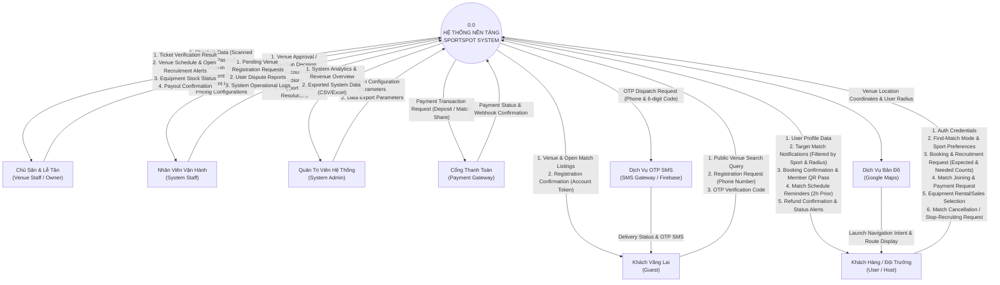

# 🌐 Tổng Quan Sản Phẩm (Product Overview)

## 1. Tầm nhìn & Định vị sản phẩm (Vision & Value Proposition)
* **SportSpot** là nền tảng di động đa thể thao (Multi-Sport Platform) tiên phong kết hợp giữa **Đặt sân trực tuyến (Venue Booking)**, **Tuyển vãng lai 2 chiều (Dual Matchmaking)** và **Vé điện tử ngoại tuyến (Offline QR Pass)**.
* **Tuyên ngôn giá trị độc bản (Unique Value Proposition - UVP):**
  * *Dành cho Người chơi (Players):* Tìm sân trong 1 phút, không lo thiếu chân đá bóng/đánh cầu, chi phí chia đều tự động minh bạch, check-in nhận sân không cần mạng 4G.
  * *Dành cho Chủ sân (Venue Owners):* Lấp đầy các khung giờ trống vắng khách, hỗ trợ gán khách lẻ tại quầy để tối đa hóa doanh thu, quản lý đồ thuê/bán và quyết toán tiền cọc an toàn.

---

## 2. Phân tích đối thủ cạnh tranh (Competitive Analysis)

| Tiêu chí | Đặt sân truyền thống (Zalo/Alo) | Các ứng dụng đặt sân hiện nay | SportSpot Platform |
| :--- | :--- | :--- | :--- |
| **Xem tình trạng sân** | Gọi điện hỏi, chờ phản hồi lâu. | Xem lịch nhưng chậm đồng bộ. | **Lưới slot trực quan real-time**, trạng thái 3 màu rõ ràng. |
| **Giải quyết thiếu người** | Tự đăng bài lên các hội nhóm Facebook. | Rất ít app hỗ trợ ghép đội. | **Tuyển vãng lai 2 chiều:** App bắn thông báo 5-10km + Lễ tân quầy gán khách lẻ. |
| **Chia sẻ chi phí** | Đội trưởng tự tính nhẩm, dễ cãi cọ. | Không có tính năng chia tiền. | **Hệ thống tự động chia đều tiền sân**, vãng lai đóng tiền trừ thẳng vào tiền sân của Host. |
| **Check-in khi mất mạng** | Đọc tên, tìm tin nhắn xác nhận. | Bắt buộc phải có mạng 4G/Wi-Fi. | **Offline QR Pass:** Tự sinh mã QR trên máy, mở vé không cần 4G. |
| **Quản lý sức chứa** | Chủ sân khó kiểm soát quá tải. | Gán cứng gây phiền toái. | **Linh hoạt tuyệt đối:** Không ép cứng sức chứa, Host chủ động điều phối. |

---

## 3. Sơ đồ ngữ cảnh hệ thống (Context Diagram - DFD Level 0)

Toàn bộ các luồng dữ liệu (Data Flows) tuân thủ 100% nguyên tắc: **Qua hệ thống trung tâm SportSpot System**, **Mỗi Request có đúng 1 Response tương ứng**, và **100% nhãn là Cụm danh từ (Noun Phrases)**:

---

## 4. Chân dung người dùng mục tiêu (User Personas)

### Persona 1: Nguyễn Văn Nam (24 tuổi - Khách vãng lai tìm kèo)
* **Nghề nghiệp:** Lập trình viên tại Cầu Giấy, Hà Nội.
* **Môn thể thao:** Cầu lông (trình độ Trung bình / Intermediate).
* **Nỗi đau:** Nhóm bạn cuối tuần hay bận đột xuất, muốn đánh cầu phải lên Facebook tìm bài nhưng khó tìm được sân gần nhà và giờ phù hợp. Sợ bị đội khác chặt chém tiền sân.
* **Hành vi trên SportSpot:** Bật "Chế độ tìm kèo", chọn Cầu lông, bán kính 5km $
ightarrow$ Nhận thông báo sân cách nhà 2km đang tuyển 1 người với giá hiển thị rõ 45.000đ $
ightarrow$ Bấm tham gia, cọc tiền qua MoMo $
ightarrow$ Nhận mã vé QR riêng để đến sân quét vào chơi.

### Persona 2: Hoàng Hải (28 tuổi - Đội trưởng FC Cầu Giấy / Sân bóng mini TP.HCM)
* **Nghề nghiệp:** Trưởng nhóm bóng đá phong trào.
* **Nỗi đau:** Đặt sân 5 giá 600.000đ nhưng đội nội bộ chỉ có 6 người. Thiếu 4 người để chia 2 đội đá đối kháng. Rủ người ngoài thì sợ họ bùng kèo khiến mình phải tự ôm trọn 600.000đ tiền sân.
* **Hành vi trên SportSpot:** Đặt sân, cọc 50% (300.000đ), tick chọn *"Tuyển vãng lai"*, nhập Tổng người: 10, Cần tìm: 4. App tự tính thu mỗi vãng lai 60.000đ. Có 2 vãng lai đăng ký qua app và 1 khách lẻ được lễ tân quầy gán vào $
ightarrow$ Hệ thống tự động trừ $3 	imes 60k = 180k$ vào tiền sân của Hải. Đến sát giờ thi đấu, Hải chủ động bấm *"Dừng tuyển"* để chốt 9 người đá.

### Persona 3: Chú Bảy (52 tuổi - Chủ cụm sân bóng đá cỏ nhân tạo Quận 7, TP.HCM)
* **Nhu cầu:** Tối đa hóa công suất sân các khung giờ từ 17:30 - 21:30. Cho thuê thêm áo pitch, bán nước giải khát.
* **Nỗi đau:** Nhiều ca đặt sân bị trống người chơi, khách lẻ đến hỏi sân nhưng không biết ghép vào đâu; quản lý sổ sách tiền cọc ghi tay dễ nhầm lẫn.
* **Hành vi trên SportSpot:** Mở màn hình Lễ tân quầy, thấy cờ báo "Sân 5A đang tuyển vãng lai" $
ightarrow$ Khách lẻ đến quầy, chú thu tiền mặt 45.000đ rồi bấm nút **"Gán vãng lai tại quầy"** $
ightarrow$ Hệ thống trừ tiền vào đơn của Đội trưởng. Khách đến giờ quét mã QR cái "bíp" là xong, nhận tiền quyết toán an toàn qua ngân hàng.

---

## 5. Giả định & Ràng buộc dự án (Assumptions & Constraints)
* **Giả định:** Người dùng sở hữu điện thoại thông minh Android có kết nối Internet (ít nhất khi thực hiện đặt chỗ/tìm kèo); các cụm sân có thiết bị di động hoặc máy tính bảng để lễ tân quét mã QR check-in.
* **Ràng buộc môn học PRM393:**
  * Ứng dụng client bắt buộc xây dựng bằng **Flutter Framework**.
  * Lưu trữ dữ liệu ngoại tuyến bắt buộc dùng **SQLite (`sqflite`)**.
  * Chức năng nhắc lịch bắt buộc dùng **Local Notifications** của Android OS.
  * Tích hợp Cổng thanh toán (VNPay/MoMo) thực hiện qua sandbox giả lập giao dịch an toàn.
