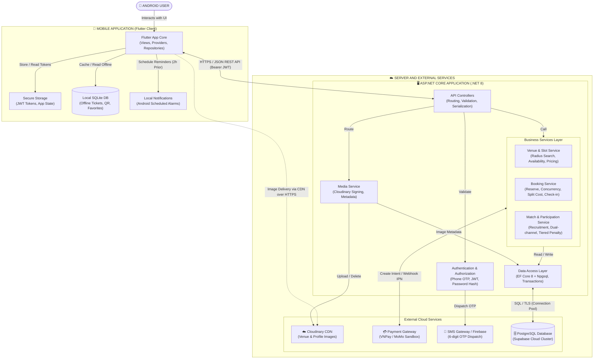

# 🏗️ Kiến Trúc Hệ Thống (System Architecture)

## 1. Sơ đồ Kiến trúc Tổng thể (System Architecture Diagram)

Sơ đồ kiến trúc toàn diện của SportSpot phản ánh chính xác cấu trúc phân tầng giữa ứng dụng di động Flutter Client, Backend Web API .NET 8, hệ thống cơ sở dữ liệu và các dịch vụ đám mây bên thứ ba:



---

## 2. Mô tả các Tầng Kiến trúc (Layer Breakdown)

### 2.1. Mobile Application Layer (Flutter Client)
* **Framework:** Flutter SDK v3.x (Dart 3.x), kiến trúc Clean Architecture rút gọn:
  * **Presentation Layer (Views & Widgets):** Sử dụng Material 3, các widget giao diện bo tròn `rounded-3xl`, theme màu Pastel Blue `#E0EEF9` và Accent Blue `#2563EB`.
  * **State Management:** `provider` (gọn nhẹ, chuẩn giáo trình PRM393).
  * **Local Storage:**
    * `shared_preferences` & `flutter_secure_storage`: Lưu Token xác thực JWT, cài đặt chế độ tìm kèo.
    * `sqflite`: Cơ sở dữ liệu SQLite lưu trữ danh sách vé, chuỗi sinh mã QR Code động và danh sách sân yêu thích ngoại tuyến.
  * **Hardware & Device Services:**
    * `flutter_local_notifications`: Lập lịch hẹn giờ thông báo trước trận đấu 2 tiếng trực tiếp trên Android OS.
    * `qr_flutter`: Thư viện render mã QR Code trực tiếp từ chuỗi payload cục bộ không cần internet.

### 2.2. Backend Application Layer (ASP.NET Core Web API)
* **Framework:** .NET 8 Web API, C# 12.
* **Cấu trúc phân tầng (Clean Architecture):**
  * **Controllers:** Tiếp nhận request HTTP, validate dữ liệu (FluentValidation), kiểm tra quyền Bearer Token JWT và trả về response JSON chuẩn.
  * **Business Services:** Chứa 100% logic nghiệp vụ: tính giá theo khung giờ cao điểm, kiểm tra chống trùng lịch (Concurrency Check), công thức tự chia tiền vãng lai, chính sách phạt hủy bậc thang.
  * **Data Access Layer:** Entity Framework Core 8 (EF Core 8) kết hợp `Npgsql` driver, hỗ trợ Database Transactions để đảm bảo an toàn dòng tiền và chống double-booking.

### 2.3. External Services Layer
* **Cloud Database (Supabase PostgreSQL):** Cụm cơ sở dữ liệu quan hệ điện toán đám mây dùng chung chuỗi Connection String cho toàn bộ thành viên nhóm.
* **Cloudinary CDN:** Dịch vụ lưu trữ và phân phối hình ảnh cụm sân, avatar người dùng qua mạng phân phối nội dung CDN HTTPS tối ưu tốc độ tải.
* **Payment Gateway (VNPay / MoMo):** Cổng thanh toán trực tuyến xử lý giao dịch đặt cọc và tham gia kèo.
* **SMS Gateway / Firebase Authentication:** Dịch vụ gửi tin nhắn mã OTP 6 số xác thực khách vãng lai.

---

## 3. Cấu trúc Thư mục Source Code Chuẩn

### 3.1. Flutter Mobile App (`sportspot_mobile/`)
```text
lib/
├── core/
│   ├── constants/         # AppColors, AppTextStyles, AppConstants
│   ├── network/           # ApiClient, Interceptors, ErrorHandlers
│   └── utils/             # CurrencyFormatter, DateTimeHelper, LocationHelper
├── data/
│   ├── local/             # DatabaseHelper (SQLite), PrefsHelper
│   ├── models/            # User, Venue, TimeSlot, Booking, OpenMatch, Service
│   └── repositories/      # VenueRepository, BookingRepository, MatchRepository
├── providers/             # AuthProvider, VenueProvider, BookingProvider, MatchProvider
├── views/
│   ├── auth/              # OnboardingScreen, PhoneOtpScreen, LoginScreen
│   ├── home/              # HomeScreen, widgets (HeroBanner, SportChips, VenueCard)
│   ├── venue_detail/      # VenueDetailScreen, TimeSlotMatrixGrid, ServiceSelector
│   ├── booking/           # CheckoutScreen, DualRecruitmentSection, SuccessScreen
│   ├── matches/           # OpenMatchFeedScreen, MatchDetailScreen, RadiusFilterDialog
│   ├── tickets/           # MyTicketsScreen, OfflineTicketPassScreen (QR Viewer)
│   ├── staff_desk/        # StaffQrScannerScreen, AssignWalkInDialog
│   └── profile/           # ProfileScreen, FindMatchSettingsScreen
└── main.dart              # Dependency Injection, Provider Setup, App Route
```

### 3.2. Backend ASP.NET Core API (`SportSpot.API/`)
```text
SportSpot.API/
├── Controllers/           # AuthController, VenuesController, BookingsController, MatchesController
├── Data/                  # AppDbContext, EntityConfigurations/
├── DTOs/                  # Requests & Responses (AuthDto, BookingDto, MatchDto)
├── Entities/              # User, Sport, Venue, SubVenue, TimeSlot, Booking, OpenMatch, Transaction
├── Services/              # AuthService, VenueService, BookingService, MatchService, PaymentService
├── Migrations/            # EF Core Code-First Database Migrations
├── appsettings.json       # ConnectionStrings, JWT Settings, Cloudinary Settings
└── Program.cs             # DI Registration, Middleware Pipeline, Swagger Configuration
```
