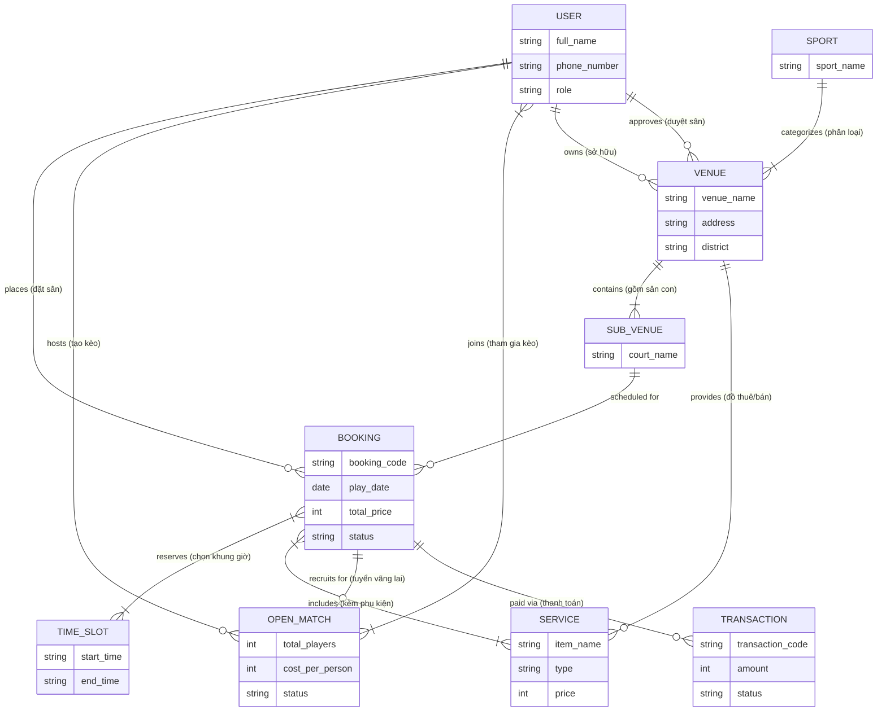
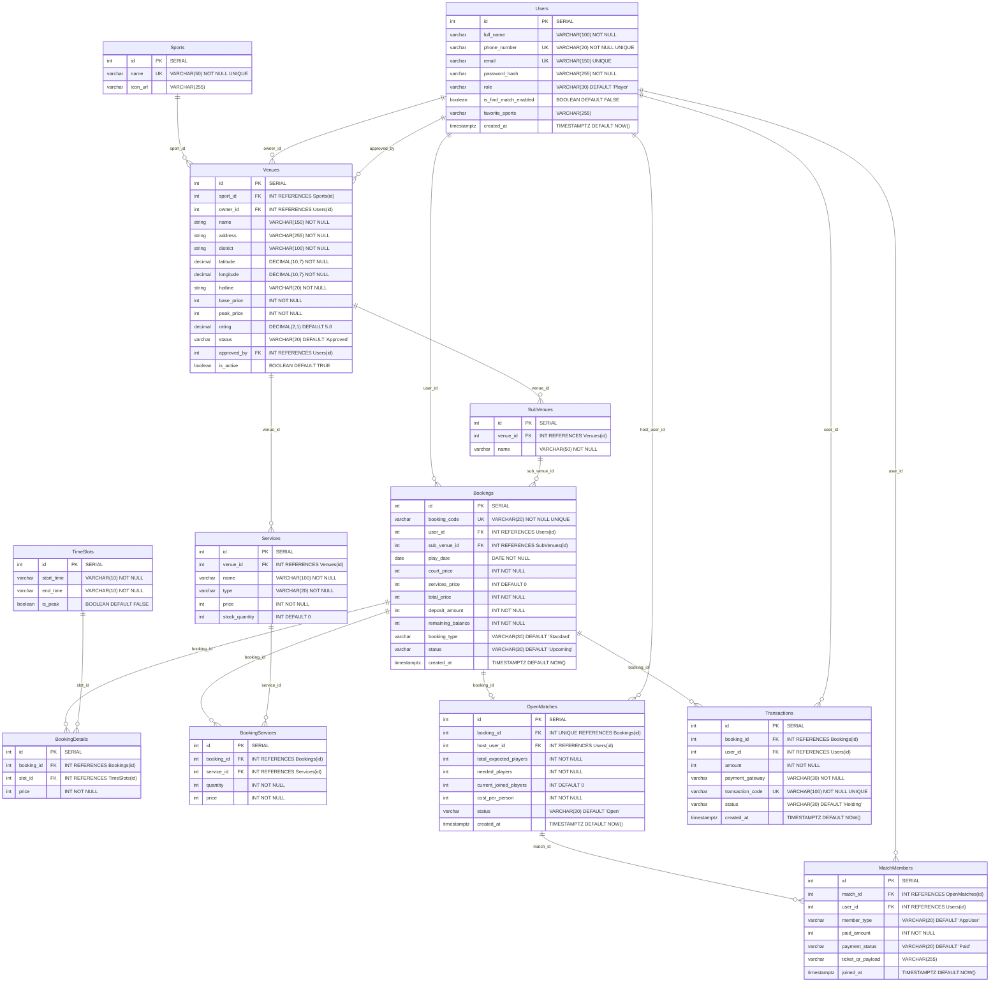
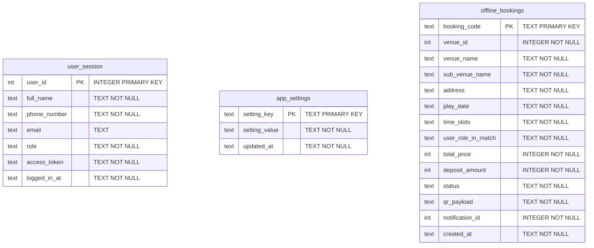

# 🗄️ Đặc Tả Dữ Liệu & Thiết Kế ERD (Data Specification & ERD)

Tài liệu cung cấp thiết kế cơ sở dữ liệu hoàn chỉnh ở cả 3 cấp độ: **Conceptual ERD**, **Logical ERD** và **Physical ERD**, kèm Từ điển dữ liệu (Data Dictionary) và script SQL DDL.

---

## 1. Mô hình ERD 3 Cấp Độ (3-Level Data Models)

### 1.1. Conceptual ERD (Mức Quan niệm - Tổng thể Nghiệp vụ)


---

### 1.2. Physical ERD (Mức Vật lý - Supabase PostgreSQL)


---

## 2. Thiết kế Local Database (SQLite trên Flutter Client)



---

## 3. Script SQL DDL Tạo Bảng Hoàn Chỉnh (PostgreSQL - Supabase)

```sql
-- 1. Bảng Users
CREATE TABLE IF NOT EXISTS "Users" (
    id SERIAL PRIMARY KEY,
    full_name VARCHAR(100) NOT NULL,
    phone_number VARCHAR(20) NOT NULL UNIQUE,
    email VARCHAR(150) UNIQUE,
    password_hash VARCHAR(255) NOT NULL,
    role VARCHAR(30) NOT NULL DEFAULT 'Player',
    is_find_match_enabled BOOLEAN NOT NULL DEFAULT FALSE,
    favorite_sports VARCHAR(255) DEFAULT 'Cầu lông,Bóng đá mini',
    created_at TIMESTAMPTZ NOT NULL DEFAULT NOW()
);

-- 2. Bảng Sports
CREATE TABLE IF NOT EXISTS "Sports" (
    id SERIAL PRIMARY KEY,
    name VARCHAR(50) NOT NULL UNIQUE,
    icon_url VARCHAR(255)
);

-- 3. Bảng Venues
CREATE TABLE IF NOT EXISTS "Venues" (
    id SERIAL PRIMARY KEY,
    sport_id INT NOT NULL REFERENCES "Sports"(id) ON DELETE CASCADE,
    owner_id INT REFERENCES "Users"(id) ON DELETE SET NULL,
    name VARCHAR(150) NOT NULL,
    address VARCHAR(255) NOT NULL,
    district VARCHAR(100) NOT NULL,
    latitude DECIMAL(10,7) NOT NULL,
    longitude DECIMAL(10,7) NOT NULL,
    description TEXT,
    hotline VARCHAR(20) NOT NULL,
    image_url VARCHAR(255),
    base_price INT NOT NULL,
    peak_price INT NOT NULL,
    rating DECIMAL(2,1) NOT NULL DEFAULT 5.0,
    status VARCHAR(20) NOT NULL DEFAULT 'Approved',
    approved_by INT REFERENCES "Users"(id) ON DELETE SET NULL,
    is_active BOOLEAN NOT NULL DEFAULT TRUE
);

-- 4. Bảng SubVenues
CREATE TABLE IF NOT EXISTS "SubVenues" (
    id SERIAL PRIMARY KEY,
    venue_id INT NOT NULL REFERENCES "Venues"(id) ON DELETE CASCADE,
    name VARCHAR(50) NOT NULL
);

-- 5. Bảng Services
CREATE TABLE IF NOT EXISTS "Services" (
    id SERIAL PRIMARY KEY,
    venue_id INT NOT NULL REFERENCES "Venues"(id) ON DELETE CASCADE,
    name VARCHAR(100) NOT NULL,
    type VARCHAR(20) NOT NULL,
    price INT NOT NULL,
    stock_quantity INT NOT NULL DEFAULT 0
);

-- 6. Bảng TimeSlots
CREATE TABLE IF NOT EXISTS "TimeSlots" (
    id SERIAL PRIMARY KEY,
    start_time VARCHAR(10) NOT NULL,
    end_time VARCHAR(10) NOT NULL,
    is_peak BOOLEAN NOT NULL DEFAULT FALSE
);

-- 7. Bảng Bookings
CREATE TABLE IF NOT EXISTS "Bookings" (
    id SERIAL PRIMARY KEY,
    booking_code VARCHAR(20) NOT NULL UNIQUE,
    user_id INT NOT NULL REFERENCES "Users"(id) ON DELETE CASCADE,
    sub_venue_id INT NOT NULL REFERENCES "SubVenues"(id) ON DELETE CASCADE,
    play_date DATE NOT NULL,
    court_price INT NOT NULL,
    services_price INT NOT NULL DEFAULT 0,
    total_price INT NOT NULL,
    deposit_amount INT NOT NULL,
    remaining_balance INT NOT NULL,
    booking_type VARCHAR(30) NOT NULL DEFAULT 'Standard',
    status VARCHAR(30) NOT NULL DEFAULT 'Upcoming',
    created_at TIMESTAMPTZ NOT NULL DEFAULT NOW()
);

-- 8. Bảng BookingDetails
CREATE TABLE IF NOT EXISTS "BookingDetails" (
    id SERIAL PRIMARY KEY,
    booking_id INT NOT NULL REFERENCES "Bookings"(id) ON DELETE CASCADE,
    slot_id INT NOT NULL REFERENCES "TimeSlots"(id) ON DELETE RESTRICT,
    price INT NOT NULL,
    CONSTRAINT UQ_BookingSlot UNIQUE (booking_id, slot_id)
);

-- 9. Bảng BookingServices
CREATE TABLE IF NOT EXISTS "BookingServices" (
    id SERIAL PRIMARY KEY,
    booking_id INT NOT NULL REFERENCES "Bookings"(id) ON DELETE CASCADE,
    service_id INT NOT NULL REFERENCES "Services"(id) ON DELETE RESTRICT,
    quantity INT NOT NULL,
    price INT NOT NULL
);

-- 10. Bảng OpenMatches
CREATE TABLE IF NOT EXISTS "OpenMatches" (
    id SERIAL PRIMARY KEY,
    booking_id INT NOT NULL UNIQUE REFERENCES "Bookings"(id) ON DELETE CASCADE,
    host_user_id INT NOT NULL REFERENCES "Users"(id) ON DELETE CASCADE,
    total_expected_players INT NOT NULL,
    needed_players INT NOT NULL,
    current_joined_players INT NOT NULL DEFAULT 0,
    cost_per_person INT NOT NULL,
    status VARCHAR(20) NOT NULL DEFAULT 'Open',
    created_at TIMESTAMPTZ NOT NULL DEFAULT NOW()
);

-- 11. Bảng MatchMembers
CREATE TABLE IF NOT EXISTS "MatchMembers" (
    id SERIAL PRIMARY KEY,
    match_id INT NOT NULL REFERENCES "OpenMatches"(id) ON DELETE CASCADE,
    user_id INT REFERENCES "Users"(id) ON DELETE SET NULL,
    member_type VARCHAR(20) NOT NULL DEFAULT 'AppUser',
    paid_amount INT NOT NULL,
    payment_status VARCHAR(20) NOT NULL DEFAULT 'Paid',
    ticket_qr_payload VARCHAR(255),
    joined_at TIMESTAMPTZ NOT NULL DEFAULT NOW()
);

-- 12. Bảng Transactions
CREATE TABLE IF NOT EXISTS "Transactions" (
    id SERIAL PRIMARY KEY,
    booking_id INT NOT NULL REFERENCES "Bookings"(id) ON DELETE CASCADE,
    user_id INT NOT NULL REFERENCES "Users"(id) ON DELETE CASCADE,
    amount INT NOT NULL,
    payment_gateway VARCHAR(30) NOT NULL,
    transaction_code VARCHAR(100) NOT NULL UNIQUE,
    status VARCHAR(30) NOT NULL DEFAULT 'Holding',
    created_at TIMESTAMPTZ NOT NULL DEFAULT NOW()
);
```

---

## 4. Dữ Liệu Mẫu Khởi Tạo (Seed Data Script)

```sql
-- 1. Sports
INSERT INTO "Sports" (name, icon_url) VALUES 
('Bóng đá mini', 'https://cdn-icons-png.flaticon.com/512/861/861512.png'),
('Cầu lông', 'https://cdn-icons-png.flaticon.com/512/2906/2906478.png'),
('Pickleball', 'https://cdn-icons-png.flaticon.com/512/8144/8144709.png'),
('Bóng rổ', 'https://cdn-icons-png.flaticon.com/512/889/889455.png')
ON CONFLICT (name) DO NOTHING;

-- 2. Venues mẫu tại TP.HCM & Hà Nội
INSERT INTO "Venues" (sport_id, name, address, district, latitude, longitude, description, hotline, base_price, peak_price, rating, status, is_active) VALUES 
(1, 'Sân Bóng Đá Chảo Lửa', 'Số 30 Phan Thúc Duyện, Phường 4', 'Tân Bình', 10.8032, 106.6625, 'Cụm 10 sân cỏ nhân tạo đạt chuẩn FIFA.', '0901234567', 300000, 420000, 4.8, 'Approved', true),
(1, 'Sân Bóng Đá Cỏ Nhân Tạo K334', 'Số 334 Lê Văn Sỹ, Phường 2', 'Tân Bình', 10.7938, 106.6654, 'Cụm sân bóng mini đèn LED chiếu sáng hiện đại.', '0909876543', 280000, 380000, 4.7, 'Approved', true),
(2, 'CLB Cầu Lông Cầu Giấy', 'Số 35 Trần Quý Kiên, Dịch Vọng', 'Cầu Giấy', 21.0368, 105.7905, 'Cụm 6 sân thảm tiêu chuẩn thi đấu.', '0987654321', 90000, 120000, 4.9, 'Approved', true);

-- 3. SubVenues
INSERT INTO "SubVenues" (venue_id, name) VALUES 
(1, 'Sân 5A (Cỏ mới)'),
(1, 'Sân 5B (Cỏ mới)'),
(1, 'Sân 7 (Khán đài)'),
(2, 'Sân 5 số 1'),
(3, 'Sân Cầu Lông số 1 (Thảm Yonex)');

-- 4. Services
INSERT INTO "Services" (venue_id, name, type, price, stock_quantity) VALUES 
(1, 'Thuê bộ áo pitch (10 áo)', 'Rental', 50000, 20),
(1, 'Thùng nước suối Aquafina (24 chai)', 'Sale', 110000, 50),
(1, 'Mua đôi vớ bóng đá chống trượt', 'Sale', 35000, 100),
(3, 'Thuê vợt Yonex Astrox', 'Rental', 30000, 15),
(3, 'Ống cầu lông Hải Yến (12 quả)', 'Sale', 240000, 40);

-- 5. TimeSlots
INSERT INTO "TimeSlots" (start_time, end_time, is_peak) VALUES 
('16:00', '17:00', false),
('17:00', '18:00', true),
('18:00', '19:00', true),
('19:00', '20:00', true),
('20:00', '21:00', true),
('21:00', '22:00', false);
```
