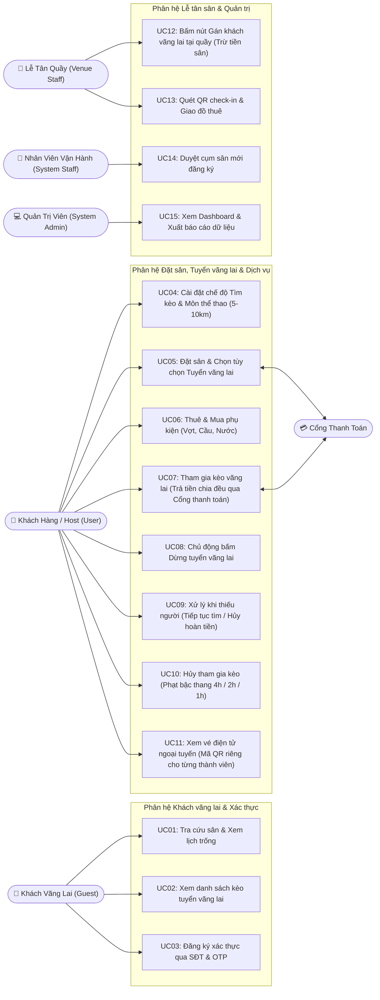
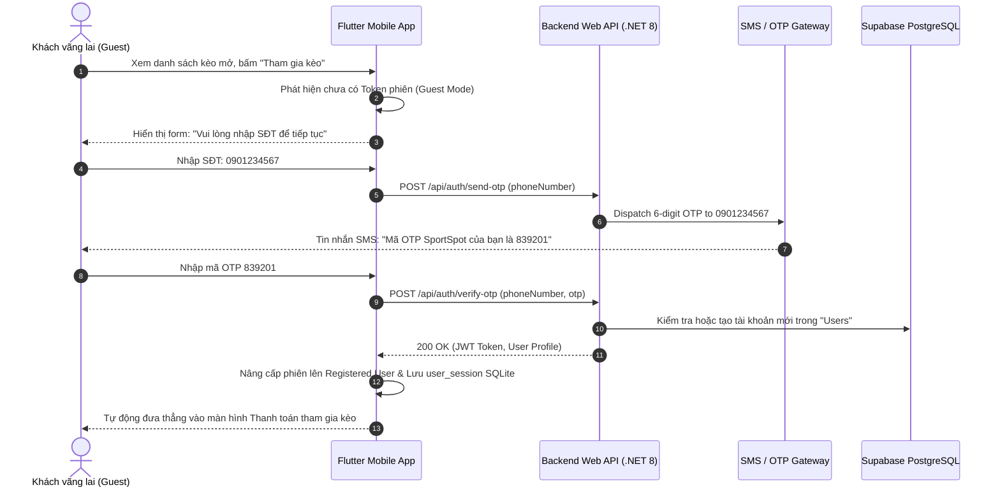
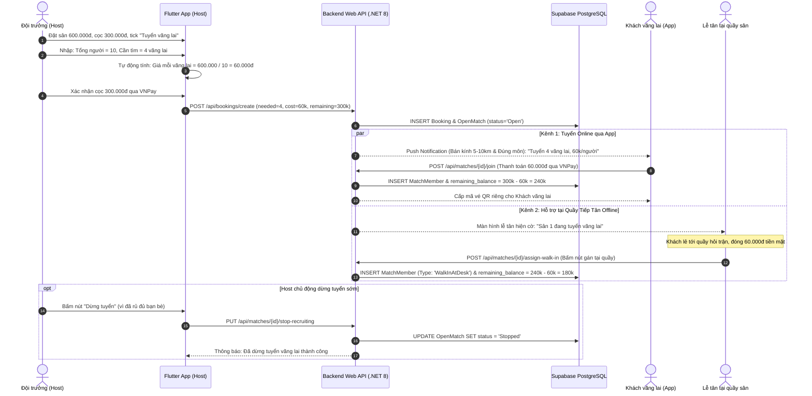
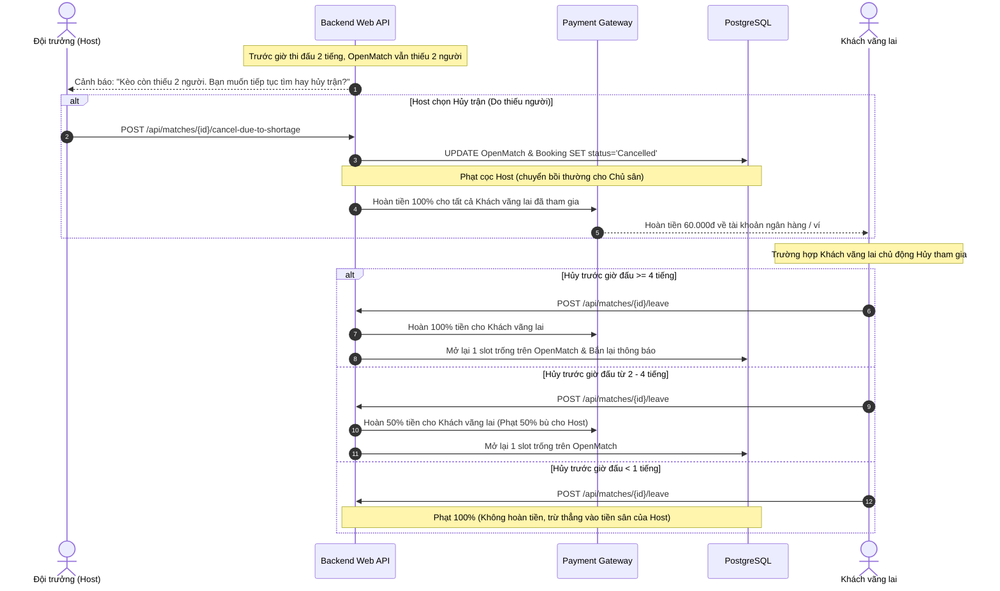
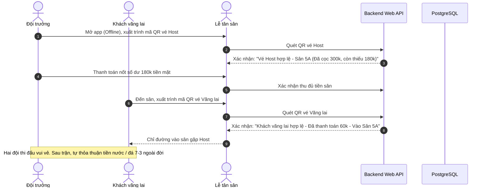

# 🔄 Sơ Đồ Use Case & Quy Trình Nghiệp Vụ (Use Cases & Workflows)

Tài liệu cung cấp sơ đồ Use Case tổng quát và các sơ đồ tuần tự (**Sequence Diagrams**) mô phỏng chi tiết 4 luồng vận hành cốt lõi của nền tảng **SportSpot**.

---

## 1. Sơ đồ Use Case Tổng Quát (Overall Use Case Diagram)

---

## 2. Các Luồng Quy Trình Tuần Tự (Sequence Diagrams)

### 2.1. Luồng Xác thực Khách vãng lai (`Guest` $
ightarrow$ `User` via Phone + OTP)

### 2.2. Luồng Tuyển Vãng Lai 2 Chiều & Tự Động Trừ Tiền Sân

### 2.3. Luồng Xử Lý Khi Thiếu Người & Phạt Hủy Kèo Bậc Thang

### 2.4. Luồng Quét QR Check-in Tại Sân Cho Từng Thành Viên (Offline Mode)

