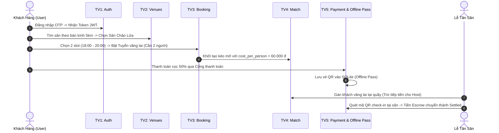

# 👥 Hướng Dẫn Phân Bổ Task & Triển Khai Độc Lập (Team Task Assignment & Zero-Blocking Guide)

> **Dự án:** SportSpot – Nền Tảng Đặt Sân Bóng & Ghép Kèo Vãng Lai Tự Động  
> **Môn học:** PRM393 - Mobile Programming (Học kỳ Fall 2026) - Nhóm 2  
> **Mục tiêu tài liệu:** Phân chia công việc công bằng cho 5 thành viên theo mô hình **Vertical Slice (Lát cắt dọc: Mỗi người đều làm cả Frontend Flutter và Backend .NET 8)**; đồng thời thiết lập **Chiến lược Mock Data Độc lập (Zero-blocking)** để toàn bộ 5 thành viên có thể code song song ngay từ ngày đầu tiên mà không bị phụ thuộc hay chờ đợi lẫn nhau.

---

## 📑 MỤC LỤC
1. [Nguyên Tắc Kỹ Thuật Cốt Lõi (Core Principles)](#1-nguyên-tắc-kỹ-thuật-cốt-lõi-core-principles)
2. [Quy Chuẩn Kiến Trúc & Cấu Trúc Thư Mục](#2-quy-chuẩn-kiến-trúc--cấu-trúc-thư-mục)
3. [Bảng Phân Bổ Tổng Quan 5 Thành Viên](#3-bảng-phân-bổ-tổng-quan-5-thành-viên)
4. [Chi Tiết Kế Hoạch & Hướng Dẫn Từng Thành Viên](#4-chi-tiết-kế-hoạch--hướng-dẫn-từng-thành-viên)
   - [Thành viên 1: Auth, User Profile & Base Foundation](#thành-viên-1-leader--auth-user-profile--base-foundation)
   - [Thành viên 2: Venue Discovery, Geo-Radius & Media CDN](#thành-viên-2-venue-discovery-geo-radius--media-cdn)
   - [Thành viên 3: Court Slots, Concurrency Lock & Core Booking](#thành-viên-3-court-slots-concurrency-lock--core-booking)
   - [Thành viên 4: Dual Matchmaking, Auto-split Cost & Walk-in Assignment](#thành-viên-4-dual-matchmaking-auto-split-cost--walk-in-assignment)
   - [Thành viên 5: Payment Escrow, Offline QR Pass & Tiered Cancellation](#thành-viên-5-payment-escrow-offline-qr-pass--tiered-cancellation)
5. [Quy Trình Tích Hợp Cuối Cùng (End-to-End Integration)](#5-quy-trình-tích-hợp-cuối-cùng-end-to-end-integration)
6. [Lộ Trình Sprint 4 Tuần (Execution Roadmap)](#6-lộ-trình-sprint-4-tuần-execution-roadmap)

---

## 1. Nguyên Tắc Kỹ Thuật Cốt Lõi (Core Principles)

Để đảm bảo dự án hoàn thành đúng hạn và 5 thành viên làm việc độc lập 100%:
1. **Vertical Slicing (Lát cắt dọc):** Mỗi thành viên chịu trách nhiệm trọn gói từ UI/UX, State Management phía Mobile đến API Controller, Business Service và Entity Database phía Backend cho module của mình.
2. **Contract-First Development:** Hợp đồng API tại [`08_API_CONTRACT.md`](./08_API_CONTRACT.md) và thiết kế ERD tại [`06_DATA_SPECIFICATION_ERD.md`](./06_DATA_SPECIFICATION_ERD.md) là **Chân lý duy nhất (SSOT)**. Mọi DTO, Model, Route, HTTP Status Code đều phải tuân thủ nghiêm ngặt theo hợp đồng này.
3. **Repository Pattern with Mock Data (Flutter):** Tất cả UI trên Flutter **không gọi trực tiếp Dio/Http Client**, mà gọi thông qua một Interface `Abstract Repository`. Trong giai đoạn đầu, mỗi bạn viết một `MockRepository` trả về dữ liệu giả lập (dùng JSON hoặc static Dart object). UI có thể bấm chuyển màn hình, test animation, validate form mượt mà ngay cả khi chưa có mạng hay server chưa chạy.
4. **Dev Bypass Auth & In-Memory Seed (.NET 8):** Phía Backend, thành viên làm Auth sẽ cung cấp `DevBypassAuthMiddleware`. Các thành viên khác chỉ cần truyền header `X-Mock-User-Id: 10` là API tự động nhận diện User mà không cần token JWT thật.

---

## 2. Quy Chuẩn Kiến Trúc & Cấu Trúc Thư Mục

Dự án sử dụng mô hình Monorepo (hoặc 2 repo độc lập) với cấu trúc chuẩn hóa:

```text
PRM393/
├── sportspot_backend/              # .NET 8 Web API
│   ├── Controllers/               # RESTful API Controllers
│   ├── Models/Entities/           # EF Core Entities (Bảng Database)
│   ├── Models/DTOs/               # Request & Response Data Transfer Objects
│   ├── Services/                  # Business Logic Services
│   ├── Data/                      # AppDbContext & SeedData
│   └── Middlewares/               # DevBypassAuth, GlobalExceptionHandler
│
└── sportspot_mobile/               # Flutter 3.x
    └── lib/
        ├── core/                  # Theme, Constants, BaseDioClient, SQLiteHelper
        └── features/              # Feature-Driven Clean Architecture
            ├── auth/              # Thành viên 1
            ├── venues/            # Thành viên 2
            ├── booking/           # Thành viên 3
            ├── matchmaking/       # Thành viên 4
            └── payment_ticket/    # Thành viên 5
                ├── data/          # models/, repositories/ (Mock & Remote)
                ├── domain/        # repository interfaces
                └── presentation/  # screens/, widgets/, controllers (Bloc/Provider/Riverpod)
```

---

## 3. Bảng Phân Bổ Tổng Quan 5 Thành Viên

| Thành viên | Trách nhiệm Module | Lát cắt Frontend (Flutter) | Lát cắt Backend (.NET 8) | Trách nhiệm chia sẻ cho Team |
| :---: | :--- | :--- | :--- | :--- |
| **TV 1** | **Xác thực, Phân quyền & Profile** | • Onboarding & Splash Screen<br>• Đăng nhập OTP / Mật khẩu<br>• Hồ sơ cá nhân & Bật chế độ tìm kèo | • `AuthController` (OTP, Login, JWT)<br>• `UsersController` (Profile, Avatar)<br>• Cấu hình JWT Authentication | Cung cấp Base Dio Client, Secure Storage & Dev Bypass Auth Middleware. |
| **TV 2** | **Cụm Sân, Bản Đồ & Bán Kính** | • Trang chủ & Banner Carousel<br>• Chip lọc thể thao & Thanh tìm kiếm<br>• Slider bán kính Haversine<br>• Chi tiết cụm sân & Hotline/Maps | • `VenuesController` (Lọc theo quận, bán kính)<br>• `SportsController`<br>• Thuật toán Haversine Formula<br>• Tích hợp Cloudinary CDN ảnh sân | Cung cấp Entity `Venue`, `Court` & Seed Data cụm sân mẫu cho các module khác. |
| **TV 3** | **Lưới Giờ & Đặt Sân Chống Trùng** | • Lưới chọn khung giờ 60/90p<br>• Kiểm tra chọn giờ liền kề<br>• Đếm ngược giữ chỗ 5 phút<br>• Tóm tắt đơn đặt sân & Dịch vụ | • `CourtsController` (Get slots theo ngày)<br>• `BookingsController` (Tạo booking)<br>• Khóa chống trùng lịch (409 Conflict)<br>• Giao dịch EF Core Transaction | Cung cấp Entity `Booking`, sinh mã `booking_code` chuẩn cho Matchmaking và Payment. |
| **TV 4** | **Ghép Kèo & Tuyển Vãng Lai** | • Bảng tin tìm kèo vãng lai<br>• Form Đăng kèo mới & Chia tiền tự động<br>• Nút Tham gia kèo & Rời kèo<br>• Giao diện Lễ tân gán vãng lai tại quầy | • `MatchesController` (CRUD kèo, Tham gia)<br>• Logic chia đều tiền: $\frac{\text{Tiền sân}}{\text{Tổng người}}$<br>• Tự động trừ tiền sân của Host<br>• Endpoint Lễ tân quầy gán vãng lai | Cung cấp API ghép kèo, trạng thái tuyển vãng lai liên kết với đơn đặt sân của TV 3. |
| **TV 5** | **Thanh Toán, Vé QR & Hủy Bậc Thang** | • Màn hình Thanh toán (Momo/Sandbox)<br>• Màn hình Vé của tôi (My Passes)<br>• Render mã QR vé đọc Offline qua SQLite<br>• Dialog xác nhận hủy kèo & Phạt bậc thang | • `PaymentsController` (Create Intent, Webhook)<br>• `TicketsController` (Verify QR tại quầy)<br>• Cơ chế Escrow (Holding $\to$ Settled)<br>• Thuật toán phạt hủy bậc thang ($\ge 4h, 2-4h, <1h$) | Cung cấp SQLite Schema cho vé offline & Mock Payment Service trả về thành công tức thì. |

---

## 4. Chi Tiết Kế Hoạch & Hướng Dẫn Từng Thành Viên

---

### Thành Viên 1 (Leader): Auth, User Profile & Base Foundation

#### 1. Thông tin phụ trách
* **Module:** Xác thực (Authentication), Phân quyền (RBAC), Hồ sơ cá nhân (User Profile).
* **Đặc tả liên quan:** Feature `F01`, `F02` trong [`03_FUNCTIONAL_REQUIREMENTS.md`](./03_FUNCTIONAL_REQUIREMENTS.md).
* **Bảng Database:** `Users` (ERD Physical).
* **Mức độ phụ thuộc:** **0%** (Không phụ thuộc ai, là nền tảng khởi tạo).

#### 2. Danh sách Task chi tiết
* `M1-BE-01`: Cấu hình Base Solution .NET 8 Web API, cài đặt EF Core Npgsql, JWT Authentication.
* `M1-BE-02`: Viết `DevBypassAuthMiddleware` để hỗ trợ cả nhóm test API mà không cần login.
* `M1-BE-03`: Triển khai `AuthController` với các endpoints:
  * `POST /api/auth/send-otp` (Sinh mã 6 số ngẫu nhiên, lưu cache 120s).
  * `POST /api/auth/verify-otp` (Kiểm tra OTP, tạo user nếu mới, trả về JWT Token).
* `M1-BE-04`: Triển khai `UsersController` với endpoint `GET /api/users/me` và `PUT /api/users/profile`.
* `M1-FE-01`: Tạo khung ứng dụng Flutter, cài đặt Theme (Màu pastel blue athletic `#2563EB`, `#E0EEF9`), Base Dio Client và Bottom Navigation Bar 4 tab.
* `M1-FE-02`: Thiết kế màn hình Onboarding (3 slide giới thiệu) kèm nút "Khám phá ngay (Khách vãng lai)".
* `M1-FE-03`: Thiết kế màn hình Nhập SĐT & Xác thực OTP (Countdown timer 120s).
* `M1-FE-04`: Thiết kế màn hình Hồ sơ cá nhân (Profile Screen) & Công tắc bật "Chế độ tìm kèo".

#### 3. Hướng dẫn Mock Data độc lập (Zero-blocking)
* **Phía Flutter:** Viết `MockAuthRepository`:
  ```dart
  class MockAuthRepository implements AuthRepository {
    @override
    Future<AuthResponse> verifyOtp(String phone, String otp) async {
      await Future.delayed(const Duration(milliseconds: 500));
      return AuthResponse(
        userId: 10,
        fullName: "Nguyễn Văn Nam",
        phoneNumber: phone,
        role: "Player",
        token: "mock_jwt_token_for_dev_phase",
      );
    }
  }
  ```
* **Phía .NET 8 (Cung cấp cho team):** Viết middleware trong `Program.cs`:
  ```csharp
  // Cho phép 4 bạn còn lại truyền Header X-Mock-User-Id: 10 để test API ngay
  app.Use(async (context, next) => {
      if (context.Request.Headers.TryGetValue("X-Mock-User-Id", out var userId)) {
          var claims = new[] {
              new Claim(ClaimTypes.NameIdentifier, userId.ToString()),
              new Claim(ClaimTypes.Role, "Player")
          };
          context.User = new ClaimsPrincipal(new ClaimsIdentity(claims, "DevMock"));
      }
      await next();
  });
  ```

#### 4. Hướng dẫn triển khai từng bước (Step-by-Step Guide)
1. **Khởi tạo:** Tạo project .NET 8 `SportSpot.Api` và project Flutter `sportspot_mobile`.
2. **Setup Base:** Cài đặt package `BCrypt.Net-Next`, `Microsoft.AspNetCore.Authentication.JwtBearer` trên BE; `dio`, `flutter_secure_storage`, `pinput` trên FE.
3. **Triển khai UI FE:** Dựng màn hình Onboarding $\to$ bấm Đăng nhập mở BottomSheet nhập số điện thoại $\to$ nhập OTP (dùng `MockAuthRepository` trả về thành công ngay khi nhập `123456`).
4. **Triển khai BE:** Viết logic sinh OTP giả lập (log ra Console/Debug log), tạo hàm sinh JWT token với claims `userId`, `role`.
5. **Đấu nối:** Đổi từ `MockAuthRepository` sang `RemoteAuthRepository` gọi trực tiếp `POST /api/auth/verify-otp`. Lưu token vào `flutter_secure_storage`.
6. **Nghiệm thu (DoD):** Chạy từ Onboarding $\to$ Nhập SĐT $\to$ Nhập OTP $\to$ Lưu Token $\to$ Vào Home hiển thị tên "Nguyễn Văn Nam".

---

### Thành Viên 2: Venue Discovery, Geo-Radius & Media CDN

#### 1. Thông tin phụ trách
* **Module:** Khám phá cụm sân (Discovery), Tìm kiếm theo bán kính (Geo-Radius Search), Chi tiết sân & Tiện ích.
* **Đặc tả liên quan:** Feature `F03`, `F04`, `F05` trong [`03_FUNCTIONAL_REQUIREMENTS.md`](./03_FUNCTIONAL_REQUIREMENTS.md).
* **Bảng Database:** `Sports`, `Venues`, `SubVenues`, `Services`.
* **Mức độ phụ thuộc:** Phụ thuộc vào vị trí User và Auth (lấy token).
* **Giải pháp Mock:** Tự hardcode tọa độ User tại Quận 9 (`lat: 10.8415, lng: 106.8098`) để tính khoảng cách Haversine.

#### 2. Danh sách Task chi tiết
* `M2-BE-01`: Thiết kế Entity `Venue`, `SubVenue`, `Service`, `Sport` theo đúng `06_DATA_SPECIFICATION_ERD.md`.
* `M2-BE-02`: Viết Seed Data gồm 5 cụm sân bóng đá mini tại TP.HCM (Quận Tân Bình, Quận 7, TP. Thủ Đức, Bình Thạnh) kèm tọa độ thực tế.
* `M2-BE-03`: Triển khai `VenuesController`:
  * `GET /api/venues?latitude=...&longitude=...&radiusKm=5&sportId=1`: Tính khoảng cách bằng công thức Haversine trong C# / SQL và sắp xếp từ gần đến xa.
  * `GET /api/venues/{id}`: Trả về chi tiết sân, danh sách sân con (SubVenues 5 người, 7 người), bảng giá và dịch vụ thuê/bán kèm theo.
* `M2-FE-01`: Thiết kế Trang chủ (Home Screen):
  * Header hiển thị vị trí hiện tại (vd: "TP. Thủ Đức, TP.HCM").
  * Banner trượt khuyến mãi tự động (`CarouselSlider`).
  * Chip chọn môn thể thao (Bóng đá, Cầu lông, Pickleball, Bóng rổ).
* `M2-FE-02`: Thiết kế Thanh tìm kiếm (Search bar) có tính năng Debounce 400ms và Slider chọn bán kính (1km - 20km).
* `M2-FE-03`: Thiết kế Thẻ hiển thị sân bóng (Venue Card) gồm ảnh đại diện, khoảng cách (`📍 2.5 km`), giá từ, đánh giá sao.
* `M2-FE-04`: Thiết kế Màn hình Chi tiết cụm sân (Venue Detail Screen): Gallery ảnh lướt ngang, danh sách tiện ích (Gửi xe, Nước uống, Tắm nóng lạnh), nút "Gọi hotline" (`url_launcher`) và "Chỉ đường" (Mở Google Maps).

#### 3. Hướng dẫn Mock Data độc lập (Zero-blocking)
* **Phía Flutter:** Tạo file `mock_venues.json` đặt trong thư mục `assets/mock/` với 3 sân bóng mẫu.
* **Class Mock Repository:**
  ```dart
  class MockVenueRepository implements VenueRepository {
    @override
    Future<List<VenueModel>> getVenues({double? lat, double? lng, double? radius}) async {
      await Future.delayed(const Duration(milliseconds: 300));
      return [
        VenueModel(
          id: 1,
          name: "Sân Bóng Đá Chảo Lửa",
          address: "Số 30 Phan Thúc Duyện, P.4, Tân Bình",
          distanceKm: 2.1,
          minPrice: 300000,
          rating: 4.8,
          imageUrl: "https://images.unsplash.com/photo-1529900748604-07564a03e7a6",
          openMatchesCount: 2,
        ),
        VenueModel(
          id: 2,
          name: "Sân Bóng Mini Thảo Điền",
          address: "28 Thảo Điền, TP. Thủ Đức",
          distanceKm: 4.5,
          minPrice: 350000,
          rating: 4.6,
          imageUrl: "https://images.unsplash.com/photo-1574629810360-7efbbe195018",
          openMatchesCount: 0,
        ),
      ];
    }
  }
  ```

#### 4. Hướng dẫn triển khai từng bước (Step-by-Step Guide)
1. **Dựng Entity & Seed Data:** Viết Entity và tạo DbContext seed sẵn danh sách 5 sân bóng có thật tại TP.HCM.
2. **Viết thuật toán Haversine trên BE:**
   $$\Delta d = 2R \cdot \arcsin\left(\sqrt{\sin^2\left(\frac{\Delta\varphi}{2}\right) + \cos(\varphi_1)\cos(\varphi_2)\sin^2\left(\frac{\Delta\lambda}{2}\right)}\right)$$
   Viết unit test cho hàm tính khoảng cách đảm bảo tính chính xác theo km.
3. **Triển khai UI Flutter:** Dựng Trang chủ bằng `MockVenueRepository`. Kéo thanh Slider bán kính thay đổi thì danh sách sân tự cập nhật filter.
4. **Tích hợp:** Chuyển sang gọi API `GET /api/venues`, truyền tọa độ hiện tại của thiết bị (dùng package `geolocator`).
5. **Nghiệm thu (DoD):** Mở app thấy danh sách sân $\to$ kéo slider bán kính 3km $\to$ danh sách tự lọc đúng các sân trong 3km $\to$ bấm vào sân xem chi tiết và bấm mở Google Maps thành công.

---

### Thành Viên 3: Court Slots, Concurrency Lock & Core Booking

#### 1. Thông tin phụ trách
* **Module:** Tra cứu khung giờ (Slots Grid), Đặt sân chống trùng lịch (Concurrency Booking), Đếm ngược giữ chỗ (Hold Timer).
* **Đặc tả liên quan:** Feature `F06`, `F07`, `F12` trong [`03_FUNCTIONAL_REQUIREMENTS.md`](./03_FUNCTIONAL_REQUIREMENTS.md).
* **Bảng Database:** `Bookings`, `BookingDetails`, `TimeSlots`, `BookingServices`.
* **Mức độ phụ thuộc:** Cần thông tin sân (`venueId`, `subVenueId`) của TV 2.
* **Giải pháp Mock:** Cố định `subVenueId = 1` để test trọn vẹn luồng đặt sân mà không cần đợi TV 2 xong UI chọn sân.

#### 2. Danh sách Task chi tiết
* `M3-BE-01`: Thiết kế Entity `Booking`, `BookingDetail`, `TimeSlot`, `BookingService`.
* `M3-BE-02`: Triển khai `CourtsController`:
  * `GET /api/venues/{venueId}/subvenues/{subVenueId}/slots?date=YYYY-MM-DD`: Trả về danh sách các khung giờ 60 phút từ 06:00 đến 23:00 kèm trạng thái: `Available` (Trống), `Booked` (Đã đặt), `Holding` (Đang giữ chỗ).
* `M3-BE-03`: Triển khai `BookingsController`:
  * `POST /api/bookings`: Nhận danh sách `slotIds`, ngày đá, dịch vụ kèm theo.
  * **Cơ chế chống trùng lịch (Concurrency Lock):** Mở Database Transaction, kiểm tra xem có slot nào đã bị người khác đặt chưa. Nếu có $\to$ Rollback và trả về HTTP `409 Conflict`.
  * Sinh mã đặt chỗ duy nhất `booking_code` (format: `SP-XXXXXX`) và tính tiền cọc mặc định 50%.
* `M3-FE-01`: Thiết kế Thanh chọn ngày trượt ngang (7 ngày tới: hôm nay, ngày mai,...).
* `M3-FE-02`: Thiết kế Lưới ma trận khung giờ (Time-slot Grid):
  * Ô màu xanh lá: Giờ trống.
  * Ô màu xám: Giờ đã qua hoặc đã có người đặt.
  * Ô màu xanh dương: Đang chọn.
* `M3-FE-03`: Viết hàm kiểm tra chọn khung giờ liên tiếp (Consecutive Slot Validation): Nếu người dùng chọn slot 17:00-18:00 và bấm tiếp 19:00-20:00 $\to$ Hiển thị Toast cảnh báo: *"Vui lòng chọn các khung giờ liền kề nhau!"*.
* `M3-FE-04`: Thiết kế Màn hình Tóm tắt đặt sân (Booking Checkout Screen):
  * Danh sách giờ đã chọn, tiền sân.
  * Mục chọn dịch vụ phụ trợ: Nước suối (+10k), Áo pitch (+20k), Thuê bóng (+30k) có nút tăng giảm số lượng (+ / -).
  * Đồng hồ đếm ngược giữ chỗ 5:00 phút. Nếu hết 5 phút chưa thanh toán thì tự hủy slot và quay về trang chủ.

#### 3. Hướng dẫn Mock Data độc lập (Zero-blocking)
* **Phía Flutter:** Viết `MockBookingRepository`:
  ```dart
  class MockBookingRepository implements BookingRepository {
    @override
    Future<List<TimeSlotModel>> getSlots(int subVenueId, DateTime date) async {
      return [
        TimeSlotModel(slotId: 1, startTime: "17:00", endTime: "18:00", price: 300000, status: "Available"),
        TimeSlotModel(slotId: 2, startTime: "18:00", endTime: "19:00", price: 350000, status: "Available"),
        TimeSlotModel(slotId: 3, startTime: "19:00", endTime: "20:00", price: 350000, status: "Booked"),
        TimeSlotModel(slotId: 4, startTime: "20:00", endTime: "21:00", price: 300000, status: "Available"),
      ];
    }

    @override
    Future<BookingResult> createBooking(BookingRequest request) async {
      await Future.delayed(const Duration(milliseconds: 600));
      return BookingResult(
        bookingCode: "SP-728194",
        courtPrice: 650000,
        totalPrice: 700000,
        depositAmount: 350000,
        paymentUrl: "https://sandbox.vnpay.vn/test-payment",
      );
    }
  }
  ```

#### 4. Hướng dẫn triển khai từng bước (Step-by-Step Guide)
1. **Thiết kế DB & Slot Generator:** Viết hàm tự sinh 17 khung giờ mỗi ngày cho mỗi sân con.
2. **Cơ chế Concurrency Transaction trên .NET 8:**
   ```csharp
   using var transaction = await _context.Database.BeginTransactionAsync(IsolationLevel.Serializable);
   var isConflict = await _context.BookingDetails.AnyAsync(b => request.SlotIds.Contains(b.SlotId) && b.Booking.PlayDate == request.PlayDate);
   if (isConflict) return Conflict(new { success = false, message = "Khung giờ này vừa có người đặt!" });
   // Tiếp tục lưu booking...
   await transaction.CommitAsync();
   ```
3. **Triển khai UI Flutter:** Dựng lưới chọn giờ $\to$ bắt sự kiện chọn nhiều slot $\to$ validate liên tiếp $\to$ chuyển sang màn hình Checkout hiển thị tổng tiền chính xác.
4. **Tích hợp API:** Đổi sang gọi API thật `POST /api/bookings`. Mở 2 máy ảo/tab cùng bấm đặt 1 slot để kiểm tra lỗi `409 Conflict`.
5. **Nghiệm thu (DoD):** Chọn 2 slot 17:00-19:00 liên tiếp $\to$ Thêm 2 chai nước $\to$ Bấm Đặt sân $\to$ Nhận được mã `SP-XXXXXX` với tổng tiền khớp $100\%$, không bao giờ bị trùng lịch.

---

### Thành Viên 4: Dual Matchmaking, Auto-split Cost & Walk-in Assignment

#### 1. Thông tin phụ trách
* **Module:** Tuyển vãng lai 2 chiều (Dual Matchmaking), Thuật toán tự chia đều tiền sân, Lễ tân gán khách tại quầy.
* **Đặc tả liên quan:** Feature `F11` trong [`03_FUNCTIONAL_REQUIREMENTS.md`](./03_FUNCTIONAL_REQUIREMENTS.md) và Quy tắc nghiệp vụ `BR-02`, `BR-03`, `BR-04` trong [`05_BUSINESS_RULES.md`](./05_BUSINESS_RULES.md).
* **Bảng Database:** `OpenMatches`, `MatchMembers`.
* **Mức độ phụ thuộc:** Cần `bookingId` của TV 3.
* **Giải pháp Mock:** Sử dụng `mock_booking_id = 99` với tổng tiền sân cố định là 600,000 VNĐ để test logic chia tiền và tuyển thành viên mà không cần chờ TV 3.

#### 2. Danh sách Task chi tiết
* `M4-BE-01`: Thiết kế Entity `OpenMatch`, `MatchMember` liên kết với `Booking` và `User`.
* `M4-BE-02`: Triển khai Logic tự động tính tiền vãng lai trong Service:
  $$\text{cost\_per\_person} = \text{ROUND}\left(\frac{\text{Tiền sân}}{\text{Tổng số người dự kiến}}\right)$$
* `M4-BE-03`: Triển khai `MatchesController`:
  * `GET /api/matches`: Lấy danh sách các kèo đang mở tuyển (lọc theo quận, trình độ, môn thể thao).
  * `POST /api/matches`: Tạo kèo tuyển vãng lai gắn với một đơn đặt sân.
  * `POST /api/matches/{id}/join`: Người chơi bấm tham gia kèo online $\to$ Hệ thống trừ tiền sân còn lại của Host:
    $$\text{remaining\_balance} = \text{remaining\_balance} - \text{cost\_per\_person}$$
  * `POST /api/matches/{id}/walkin-members`: Lễ tân sân gán khách lẻ tại quầy $\to$ Hệ thống cập nhật giảm số người cần tuyển và trừ tiếp tiền sân cho Host.
  * `POST /api/matches/{id}/leave`: Người chơi hủy kèo $\to$ Tự động mở lại 1 slot trống cho cộng đồng.
* `M4-FE-01`: Thiết kế Màn hình Bảng tin Ghép kèo (Open Match Feed): Thẻ trận đấu hiển thị sân, giờ đá, số người còn thiếu (vd: `Thiếu 2 người`), chi phí mỗi người (`45.000 đ/người`).
* `M4-FE-02`: Thiết kế Form "Bật tuyển vãng lai" tích hợp vào bước Đặt sân: Cho Host nhập *Tổng người dự kiến* (vd: 10) và *Cần tuyển* (vd: 4). UI tự động tính và hiển thị preview số tiền mỗi người phải đóng.
* `M4-FE-03`: Thiết kế Màn hình Chi tiết Kèo đấu (Match Detail Screen): Danh sách avatar các thành viên đã tham gia, trạng thái thanh toán, nút "Tham gia kèo".
* `M4-FE-04`: Thiết kế Màn hình Lễ tân sân (Staff Desk View): Danh sách các ca đấu sắp đá đang thiếu người kèm nút bấm **"+ Gán khách vãng lai tại quầy"**.

#### 3. Hướng dẫn Mock Data độc lập (Zero-blocking)
* **Phía Flutter:** Viết `MockMatchRepository`:
  ```dart
  class MockMatchRepository implements MatchRepository {
    @override
    Future<List<OpenMatchModel>> getOpenMatches() async {
      return [
        OpenMatchModel(
          matchId: 12,
          venueName: "Sân Bóng Chảo Lửa - Sân 5A",
          playTime: "18:00 - 19:30 Hôm nay",
          totalPlayers: 10,
          joinedPlayers: 8,
          neededPlayers: 2,
          costPerPerson: 60000,
          hostName: "Trần Hoàng Long",
        ),
      ];
    }
  }
  ```

#### 4. Hướng dẫn triển khai từng bước (Step-by-Step Guide)
1. **Viết Service tính toán chia tiền sân:**
   * Tiền sân: 600,000 VNĐ. Tổng người: 10 $\to$ Tiền mỗi người: 60,000 VNĐ.
   * Host cọc 50% = 300,000 VNĐ. `remainingBalance` = 300,000 VNĐ.
   * Mỗi khi có 1 người join (online hoặc walk-in tại quầy) $\to$ `remainingBalance` giảm đi 60,000 VNĐ.
2. **Triển khai API:** Viết đủ các endpoints trong `MatchesController`, kiểm tra điều kiện không cho join quá số lượng `neededPlayers`.
3. **Triển khai UI Flutter:** Dựng tab "Tìm kèo" trên thanh điều hướng dưới $\to$ Xem danh sách kèo $\to$ Bấm tham gia kèo.
4. **Màn hình Lễ tân quầy:** Dựng 1 màn hình đơn giản dành cho role `Staff`, có danh sách ca đấu và nút gán khách lẻ.
5. **Nghiệm thu (DoD):** Tạo kèo cần 2 người $\to$ 1 người join online $\to$ Lễ tân gán 1 người tại quầy $\to$ Kèo tự động chuyển trạng thái `Full/Closed`, tiền sân của Host được khấu trừ đủ 100%.

---

### Thành Viên 5: Payment Escrow, Offline QR Pass & Tiered Cancellation

#### 1. Thông tin phụ trách
* **Module:** Cổng thanh toán (Payment Gateway & Webhook), Cơ chế Escrow giữ tiền, Vé điện tử xem Offline qua SQLite (Offline QR Pass), Chính sách hủy phạt bậc thang.
* **Đặc tả liên quan:** Feature `F08`, `F09`, `F10` trong [`03_FUNCTIONAL_REQUIREMENTS.md`](./03_FUNCTIONAL_REQUIREMENTS.md) và Quy tắc nghiệp vụ `BR-05`, `BR-06` trong [`05_BUSINESS_RULES.md`](./05_BUSINESS_RULES.md).
* **Bảng Database:** `Transactions`, `Tickets` (Local SQLite: `local_tickets`).
* **Mức độ phụ thuộc:** Cần `bookingId` của TV 3 hoặc `matchId` của TV 4 để thanh toán và sinh vé.
* **Giải pháp Mock:** Cung cấp nút "Thanh toán giả lập (Mock Sandbox)" cho toàn đội bấm là sinh vé thành công ngay lập tức để test.

#### 2. Danh sách Task chi tiết
* `M5-BE-01`: Thiết kế Entity `Transaction`, `Ticket`.
* `M5-BE-02`: Triển khai `PaymentsController`:
  * `POST /api/payments/create-intent`: Tạo link thanh toán VNPay / MoMo Sandbox hoặc Mock Payment URL.
  * `POST /api/payments/webhook-ipn`: Nhận callback thanh toán thành công $\to$ Đổi trạng thái tiền cọc sang `Holding` (Escrow) $\to$ Tự động sinh bản ghi Ticket và mã QR Payload (`SPORTSPOT|CODE|USER_ID|ROLE`).
* `M5-BE-03`: Triển khai `TicketsController`:
  * `GET /api/tickets/my-tickets`: Lấy danh sách vé đã mua của User.
  * `POST /api/tickets/verify-qr`: API cho nhân viên sân quét mã QR để Check-in. Khi quét thành công $\to$ Trạng thái chuyển sang `Settled` (Tiền cọc giải ngân cho chủ sân).
* `M5-BE-04`: Viết thuật toán Hủy vé phạt bậc thang (Tiered Refund):
  * Trước $\ge 4h$: Hoàn $100\%$ tiền cho khách.
  * Trước $2h - 4h$: Hoàn $50\%$, phạt $50\%$ để bồi thường cho Host/Sân.
  * Dưới $1h$: Phạt $100\%$ (Không hoàn tiền).
* `M5-FE-01`: Thiết kế Màn hình Thanh toán (Checkout Payment Screen) với các tùy chọn: VNPay, MoMo, Thẻ ATM và Sandbox Test.
* `M5-FE-02`: Cấu hình Local Database SQLite (package `sqflite`) lưu trữ vé ngoại tuyến:
  * Khi có mạng: Tải vé từ Server về và lưu/cập nhật vào bảng `local_tickets` trong SQLite.
  * Khi mất mạng (Offline hoàn toàn): Đọc vé trực tiếp từ SQLite lên màn hình.
* `M5-FE-03`: Thiết kế Màn hình Vé của tôi (My Passes Screen): Render mã QR động (package `qr_flutter`) kèm huy hiệu "Offline Ready" hiển thị rõ ràng khi không có kết nối internet.
* `M5-FE-04`: Thiết kế Dialog Hủy vé: Tính toán và hiển thị rõ số tiền được hoàn và số tiền bị phạt dựa theo mốc thời gian thực trước giờ thi đấu.

#### 3. Hướng dẫn Mock Data độc lập (Zero-blocking)
* **Phía Backend (M5 viết cho cả nhóm dùng):**
  ```csharp
  [HttpPost("mock-pay/{bookingCode}")]
  public async Task<IActionResult> MockInstantPayment(string bookingCode)
  {
      // Kích hoạt thanh toán thành công ngay lập tức để đồng đội test luồng sinh vé
      var booking = await _context.Bookings.FirstOrDefaultAsync(b => b.BookingCode == bookingCode);
      booking.Status = "Confirmed";
      var ticket = new Ticket {
          BookingId = booking.Id,
          QrPayload = $"SPORTSPOT|{booking.BookingCode}|{booking.UserId}|Host",
          Status = "Valid"
      };
      _context.Tickets.Add(ticket);
      await _context.SaveChangesAsync();
      return Ok(new { success = true, message = "Thanh toán thành công (MOCK)" });
  }
  ```

#### 4. Hướng dẫn triển khai từng bước (Step-by-Step Guide)
1. **Thiết lập SQLite trên Flutter:** Tạo file `sqlite_helper.dart` khởi tạo bảng `local_tickets` lưu `booking_code`, `venue_name`, `play_time`, `qr_payload`.
2. **Triển khai hiển thị QR Offline:** Dùng `qr_flutter` render mã QR từ chuỗi `qr_payload`. Bật chế độ máy bay (Airplane Mode) để kiểm tra vé vẫn mở lên và render mã QR bình thường.
3. **Triển khai Backend Escrow & Webhook:** Viết logic giữ tiền cọc ở trạng thái `Holding`. Viết endpoint `/verify-qr` chuyển sang `Settled`.
4. **Triển khai Logic Hủy bậc thang:** Viết unit test cho hàm tính tiền hoàn theo 3 mốc thời gian: 5 tiếng trước giờ đá (100%), 3 tiếng trước giờ đá (50%), 30 phút trước giờ đá (0%).
5. **Nghiệm thu (DoD):** Đặt sân $\to$ Thanh toán Sandbox $\to$ Nhận vé QR $\to$ Tắt Wi-Fi/4G mở lại app $\to$ Vé vẫn hiển thị sắc nét $\to$ Quét QR báo check-in thành công.

---

## 5. Quy Trình Tích Hợp Cuối Cùng (End-to-End Integration)

Sau khi cả 5 thành viên hoàn thành các module độc lập với Mock Repository, nhóm tiến hành ghép nối trong 3 bước:



### Các bước chuyển đổi từ Mock sang Real API:
1. **Thay đổi cấu hình cờ Mock:** Trong file `lib/core/constants/app_constants.dart`, đổi `const bool USE_MOCK_DATA = false;`.
2. **Dependency Injection:** Cấu hình Service Locator (dùng `get_it` hoặc `Provider`):
   ```dart
   // Khi USE_MOCK_DATA = false, tự động tiêm RemoteRepository thay vì MockRepository
   getIt.registerLazySingleton<VenueRepository>(() => 
       AppConstants.USE_MOCK_DATA ? MockVenueRepository() : RemoteVenueRepository(dio));
   ```
3. **Test thông luồng E2E:** Kiểm tra từ đăng nhập $\to$ chọn sân $\to$ giữ giờ $\to$ tạo kèo $\to$ thanh toán $\to$ quét vé offline.

---

## 6. Lộ Trình Sprint 4 Tuần (Execution Roadmap)

```mermaid
gantt
    title Kế Hoạch Triển Khai PRM393 (4 Tuần)
    dateFormat  YYYY-MM-DD
    section Sprint 1: Setup & Mock UI
    Khởi tạo Monorepo & Base Setup (TV1 Leader) :s1_1, 2026-10-16, 3d
    Dựng Mock Repositories & UI tĩnh 5 Module  :s1_2, after s1_1, 4d
    section Sprint 2: Backend & Business Logic
    Viết Entity & API Controllers (.NET 8)      :s2_1, 2026-10-23, 5d
    Triển khai Logic: Haversine, Concurrency, Chia tiền :s2_2, after s2_1, 4d
    section Sprint 3: Kết Nối & Offline Feature
    Tích hợp Dio Remote & Đấu nối API           :s3_1, 2026-11-01, 4d
    Hoàn thiện SQLite Offline QR & Payment IPN  :s3_2, after s3_1, 3d
    section Sprint 4: Testing & Báo Cáo
    Kiểm thử E2E, Xử lý lỗi 409 & Edge cases    :s4_1, 2026-11-08, 4d
    Quay Video Demo & Hoàn thiện Slide PRM393   :s4_2, after s4_1, 3d
```

---

## 7. Quy Ước Commit & Quản Lý Mã Nguồn

* **Branching Strategy:**
  * `main`: Nhánh chạy ổn định, chỉ merge khi có sự đồng ý của Leader.
  * `develop`: Nhánh tích hợp chung của cả nhóm.
  * `feature/m1-auth-profile`: Nhánh của Thành viên 1.
  * `feature/m2-venue-radius`: Nhánh của Thành viên 2.
  * `feature/m3-booking-slots`: Nhánh của Thành viên 3.
  * `feature/m4-matchmaking`: Nhánh của Thành viên 4.
  * `feature/m5-payment-ticket`: Nhánh của Thành viên 5.
* **Commit Message Format (Conventional Commits):**
  * `feat(auth): implement otp countdown timer UI`
  * `feat(booking): add concurrency check with 409 conflict return`
  * `fix(venue): fix haversine distance calculation formula`
  * `mock(payment): add mock sandbox payment endpoint for team testing`
